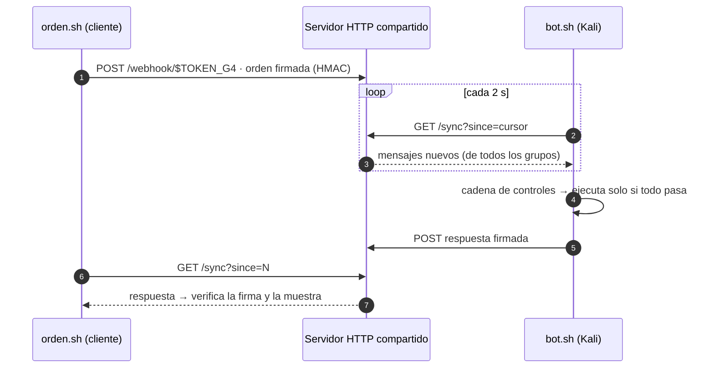
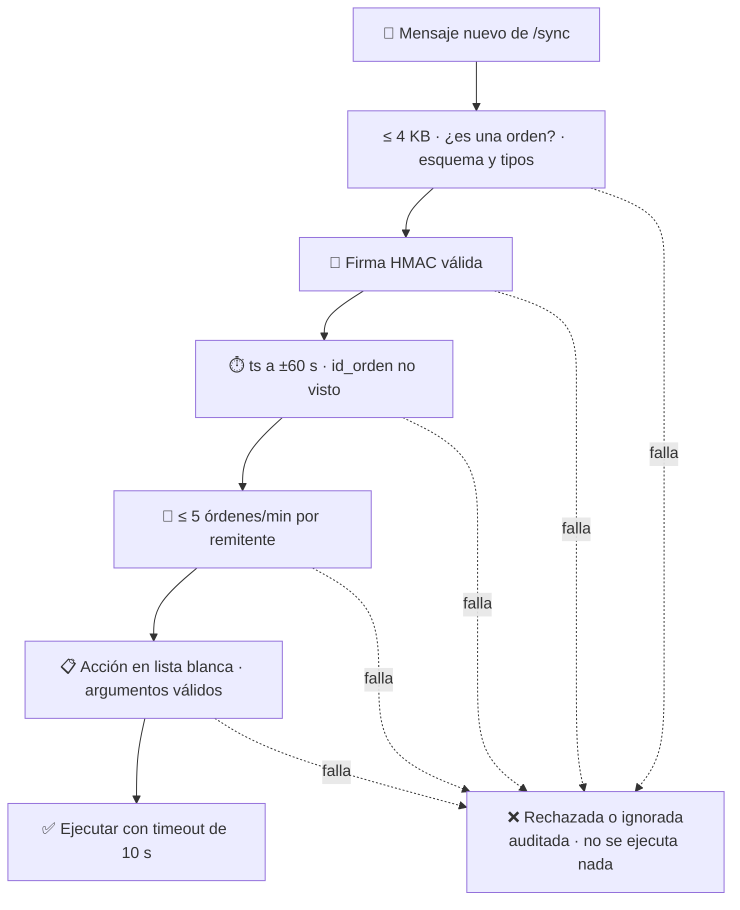

# 🔐 ChatOps Bot seguro en Bash


Bot **ChatOps** que recibe órdenes por un canal HTTP **público y compartido** y solo
ejecuta cuatro acciones de una **lista blanca** (`ping`, `estado`, `puertos`, `ayuda`).
Todo lo demás —`8.8.8.8; id`, `$(whoami)`, `-c 100000`— se rechaza **sin ejecutar nada**.

> **El reto:** los tokens de los 9 grupos se vieron en directo, así que **cualquiera puede
> publicar en nuestro canal**. El bot tiene que distinguir órdenes legítimas de ataques,
> repeticiones e inundaciones, sin perder nunca una orden ni ejecutar nada dos veces.

Proyecto de grupo del **Máster de Ciberseguridad & IA (Evolve)** — Grupo 4: Pol, Fran,
Javi, Yeray y Ricardo.

---

## ✨ Qué lo hace interesante

| Amenaza | Defensa | Cómo se demuestra |
|---|---|---|
| **Inyección de comandos** (`;`, `$( )`, `` ` ` ``, `&&`, `\|`) | Lista blanca con `case`, regex estricta y **nunca** `eval` / `bash -c` | Los ataques intentan crear `pwned` y modificar `testigo.txt`: la prueba verifica el hash y que `pwned` no existe |
| **Inyección de argumentos** (`-f`, `-c 100000`) | Nada puede empezar por `-`; siempre `"$var"` y `--` | Rechazadas en `pruebas.sh` |
| **Suplantación** (cualquiera conoce el token) | **HMAC-SHA256** sobre JSON canónico (`jq -cS`), también en las respuestas | Firma falsa, ausente o mensaje alterado tras firmar → rechazado |
| **Repetición** de órdenes capturadas | Ventana de ±60 s y `id_orden` vistos persistidos en disco, marcados **antes** de ejecutar | Id repetido y `ts` viejo → rechazados, también tras reiniciar |
| **Abuso / inundación** | 5 órdenes/min por remitente, máximo de mensajes por ciclo y de bytes por `/sync` | La sexta orden en un minuto se rechaza |
| **Mensaje envenenado** que rompe `/sync` | Salto controlado tras 3 fallos, solo si el servidor está sano | El bot lo salta (auditado) y sigue vivo |
| **Procesos colgados** | `timeout` de 10 s sin procesos huérfanos; duración medida con reloj monotónico | Un `ping` falso que se cuelga devuelve `error`/124 en 10–15 s |
| **Fuga de secretos** | Solo variables de entorno; nunca en código, logs ni auditoría | Al acabar se busca la clave y el token en todos los ficheros: 0 apariciones |
| **Manipulación de terminal** (ESC, BEL) | Limpieza de caracteres de control antes de mostrar | Salida maliciosa mostrada limpia |

Y todo queda en una **auditoría JSONL**: qué llegó, qué se decidió y por qué.

## 🏗️ Arquitectura



Cada mensaje recorre esta **cadena de controles**; el primero que falla decide y el
mensaje se rechaza o se ignora **sin ejecutar nada**:



- Hay **un solo endpoint por grupo**: órdenes y respuestas comparten canal y se distinguen
  por el campo `canal` (`ordenes-g4` / `respuestas-g4`).
- Todo el HTTP está en dos funciones, `publicar()` y `consultar()`; el resto del código no
  sabe qué servidor se usa.
- El bot recorre los mensajes **en orden de `_id`** y guarda un cursor para no tratar nada
  dos veces.

## 🚀 Pruébalo en local

No hace falta el servidor del máster: `servidor_falso.py` lo imita en `127.0.0.1:8099`,
que es a donde apuntan los scripts por defecto. Necesitas Linux (Kali, Ubuntu o WSL) con
`jq`, `curl`, `openssl`, `iproute2`, `util-linux`, `procps` y `python3`.

```bash
git clone https://github.com/yConFi/chatops-bot-seguro.git && cd chatops-bot-seguro
export TOKEN_G4="demo-$(openssl rand -hex 8)" CLAVE="$(openssl rand -hex 32)"

python3 servidor_falso.py &        # servidor local (solo pruebas)
./bot.sh &                         # el bot, en segundo plano

./orden.sh ping 8.8.8.8            # ✅ ok
./orden.sh estado                  # ✅ ok, JSON con uptime, memoria y disco
./orden.sh ping '8.8.8.8; id'      # ❌ rechazada: objetivo no válido
./orden.sh --firma-falsa estado    # ❌ rechazada: firma incorrecta
```

O lanza la batería completa, que arranca su propio servidor y bot en un entorno aislado:

```bash
./pruebas.sh       # ~5 min · 56 PASA · 0 FALLA
```

## 🧪 Pruebas

`pruebas.sh` ejecuta **56 comprobaciones automáticas** contra el servidor falso y guarda el
resultado real en [`resultados_pruebas.md`](resultados_pruebas.md). Lo importante no es
solo que el bot responda «rechazada», sino **demostrar que el ataque no tuvo efecto**:

```text
== Inyección (comillas simples) + fichero testigo
  [PASA ] ping 8.8.8.8\;\ id                         esperado=rechazada obtenido=rechazada
  [PASA ] ping \$\(touch\ /tmp/…/pwned\)             esperado=rechazada obtenido=rechazada
  [PASA ] ping 8.8.8.8\ \&\&\ touch\ /tmp/…/pwned    esperado=rechazada obtenido=rechazada
  [PASA ] fichero testigo tras los ataques           esperado=intacto obtenido=intacto
  [PASA ] fichero pwned tras los ataques             esperado=no_existe obtenido=no_existe
== Secretos fuera de logs, estado y auditoría (fila 14)
  [PASA ] ficheros que contienen CLAVE o TOKEN_G4    esperado=0 obtenido=0

Total: 56 PASA · 0 FALLA
```

Ejecutarlas en una segunda máquina (WSL) destapó un fallo real que en Kali no se veía: la
duración se medía con el reloj de pared, que WSL corrige en caliente. Ahora se usa un reloj
monotónico ([commit](https://github.com/yConFi/chatops-bot-seguro/commit/2ba7718)).

## 🧠 Lo que demuestra este proyecto

- **Bash defensivo:** `set -euo pipefail`, entrecomillado sistemático, `trap` para un cierre
  limpio, escrituras atómicas (`mktemp` + `mv`), `flock` para una sola instancia.
- **Criptografía aplicada:** firma HMAC y canonicalización de JSON para que cliente y bot
  firmen exactamente los mismos bytes.
- **Modelado de amenazas honesto:** cada defensa tiene su prueba, y las limitaciones
  conocidas están documentadas en vez de escondidas ([ver abajo](#8-limitaciones-y-supuestos)).
- **Testing de seguridad:** pruebas que verifican la *ausencia* de efectos, servidor
  simulado con ganchos para inyectar fallos (`/sync` roto, mensaje envenenado, error 500).
- **Uso crítico de la IA:** el código se diseñó con un debate entre ChatGPT (redactor) y
  Claude (auditor), con el grupo decidiendo en cada ronda. Todo el proceso está en
  [`prompts.md`](prompts.md).

## 📁 Estructura

| Fichero | Qué es |
|---|---|
| [`bot.sh`](bot.sh) | El bot: consulta órdenes, las valida y ejecuta solo acciones permitidas. |
| [`orden.sh`](orden.sh) | El cliente: envía una orden firmada y espera la respuesta. |
| [`servidor_falso.py`](servidor_falso.py) | Imitación local del servidor del máster, **solo para pruebas**. |
| [`pruebas.sh`](pruebas.sh) | Pruebas automáticas contra el servidor falso. |
| [`resultados_pruebas.md`](resultados_pruebas.md) | Resultado real de la última ejecución de `pruebas.sh` (indica fecha y máquina). |
| [`revision.md`](revision.md) | Checklist requisito → implementación → prueba, y revisión de seguridad. |
| [`prompts.md`](prompts.md) | Uso de la IA y registro de las pruebas ejecutadas. |
| [`prompt_debate_ej5.md`](prompt_debate_ej5.md) | Anexo: prompt de arranque y reglas del debate ChatGPT ↔ Claude. |
| [`ronda1_auditoria_claude.md`](ronda1_auditoria_claude.md) | Anexo: auditoría de la Ronda 1 y respuestas del grupo. |
| [`prompt_final_ej5.md`](prompt_final_ej5.md) | Anexo: prompt final con el que se generó el código. |

---

# 📖 Documentación técnica

## 1. Dependencias

Kali Linux con `bash` 5, `jq` ≥ 1.6, `curl`, `openssl`, `timeout`, `ping` (iputils), `ss`
(iproute2), `flock` (util-linux), `free`/`uptime` (procps) y `python3` (solo para las pruebas).
Cada script comprueba sus dependencias al arrancar y avisa de lo que falte:

```bash
sudo apt install jq curl openssl iputils-ping iproute2 util-linux procps python3
```

## 2. Variables de entorno

Los secretos **solo** se leen del entorno. Nunca están en el código, los ejemplos ni los logs.

| Variable | Obligatoria | Por defecto | Uso |
|---|---|---|---|
| `TOKEN_G4` | sí | — | Token del webhook del grupo. |
| `CLAVE` | sí | — (no hay clave por defecto) | Clave HMAC compartida entre el bot y el cliente. |
| `RECEPTOR` | no | `profesor` | `profesor` o `webhooksite` (este último solo es un esqueleto). |
| `EXIGIR_FIRMA` | no | `1` | `0` acepta órdenes sin firma (con aviso grande y registro en auditoría). |
| `URL_WEBHOOK` | no | `http://127.0.0.1:8099/webhook` | Base del POST; el token se añade al final. |
| `URL_SYNC` | no | `http://127.0.0.1:8099/sync` | Lectura de mensajes. |
| `DIR_ESTADO` | no | `./estado_bot` | Cursor, ids vistos, frecuencia, bloqueo y `auditoria.jsonl`. |
| `NOMBRE_BOT` | no | `kali-g4` | Campo `bot` de las respuestas. |
| `MAX_MSGS_CICLO` | no | `20` | Máximo de mensajes tratados por ciclo (defensa contra inundación). |
| `MAX_BYTES_SYNC` | no | `2000000` | Tamaño máximo aceptado de `/sync` (`curl --max-filesize`). |

## 3. Arranque contra un servidor real

```bash
chmod +x bot.sh orden.sh pruebas.sh

# Una sola vez: guardar los secretos en ficheros privados (sintaxis de zsh, la shell de Kali;
# en bash sería: read -rs -p 'TOKEN_G4: ' t). Así no quedan en el historial.
openssl rand -hex 32 > ~/.clave_g4 && chmod 600 ~/.clave_g4
read -rs "t?TOKEN_G4: "; echo; printf '%s' "$t" > ~/.token_g4 && chmod 600 ~/.token_g4; unset t

# En cada terminal (bot y cliente):
export TOKEN_G4="$(cat ~/.token_g4)" CLAVE="$(cat ~/.clave_g4)"
export URL_WEBHOOK='http://<servidor>:<puerto>/webhook' URL_SYNC='http://<servidor>:<puerto>/sync'
./bot.sh                       # terminal 1: dejarlo corriendo
./orden.sh ping 8.8.8.8        # terminal 2 (con las mismas variables exportadas)
```

- La **primera vez**, el bot empieza en el `last_id` actual y no ejecuta el histórico.
  En los reinicios continúa desde el cursor guardado.
- Solo puede haber **un bot** por `DIR_ESTADO`. Un segundo bot falla porque `flock` está
  ocupado.
- **Los relojes deben estar sincronizados**: el bot rechaza los `ts` que se separan más de
  ±60 s de su reloj. Se comprueba con `timedatectl status` y, si hace falta, se arregla con
  `sudo timedatectl set-ntp true`.

## 4. Ejemplos y formato de los mensajes

```bash
./orden.sh ping 8.8.8.8
./orden.sh estado
./orden.sh puertos
./orden.sh ayuda
./orden.sh ping '8.8.8.8; id'          # ataque → rechazada
./orden.sh --firma-falsa estado        # [PRUEBAS] → rechazada: firma incorrecta
./orden.sh --sin-firma ayuda           # [PRUEBAS] → rechazada: firma ausente
./orden.sh --ts-viejo ayuda            # [PRUEBAS] → rechazada: ts fuera de la ventana
./orden.sh --de profesor ayuda         # cambia el remitente
```

Las opciones van **antes** de la acción. Lo que va después es el objetivo literal, así
`./orden.sh ping '-f'` envía `-f` al bot (que lo rechaza).

**Orden que envía `orden.sh`**, con el contrato oficial más `canal` y `firma`:

```json
{"id_orden":"a1b2c3d4","de":"kali","accion":"ping","args":{"objetivo":"8.8.8.8"},
 "ts":"2026-11-17T11:30:00Z","canal":"ordenes-g4","firma":"<64 hex>"}
```

**Respuesta del bot:**

```json
{"id_orden":"a1b2c3d4","bot":"kali-g4","estado":"ok","codigo_salida":0,
 "salida":"PING 8.8.8.8 ... 4 packets transmitted, 4 received ...","duracion_ms":3021,
 "ts":"2026-11-17T11:30:03Z","canal":"respuestas-g4","firma":"<64 hex>"}
```

- `salida` es **siempre una cadena** de 2000 caracteres como máximo. Con `estado`,
  `puertos` y `ayuda` contiene JSON compacto válido, por ejemplo
  `"{\"uptime\":\"up 2 hours\",\"memoria_mb\":{...},\"disco_raiz_mb\":{...}}"`.
  `orden.sh` lo muestra ya desplegado.
- Si se rechaza: `"estado":"rechazada"`, `"codigo_salida":null` y `"salida":"rechazada: <motivo>"`.
- Si se agota el tiempo: `"estado":"error"` y `"codigo_salida":124`.

## 5. Seguridad: HMAC, anti-repetición, límite de frecuencia y auditoría

**Firma HMAC-SHA256.** Los tokens de los 9 grupos se vieron en el directo, así que
**cualquiera puede publicar en nuestro canal**. La firma demuestra que quien envía conoce la
`CLAVE`.

- **Cómo se firma:**
  1. Se quitan `firma` y los metadatos del servidor (`_id`, `_recibido`, `_origen`).
  2. Se aplica `jq -cS` para tener una forma canónica (claves ordenadas, sin espacios).
  3. Se calcula `openssl dgst -sha256 -hmac "$CLAVE"` sobre esos bytes.
  4. Se añade `firma` en hexadecimal.
- **Por qué la forma canónica:** el servidor añade sus campos y puede reordenar el JSON. Al
  canonicalizar, los dos lados firman lo mismo.
- **Qué hace el bot:**
  - Comprueba el formato (64 hexadecimales) antes de comparar.
  - Sin firma → `rechazada: firma ausente`.
  - Firma mal → `rechazada: firma incorrecta`.
  - Con `EXIGIR_FIRMA=0` se aceptan órdenes sin firma, pero una firma **presente e
    incorrecta** se sigue rechazando. La lista blanca protege igual.
- **Las respuestas también se firman.** `orden.sh` descarta cualquier respuesta con nuestro
  `id_orden` que no tenga una firma válida, porque cualquiera podría falsificarla.

**Anti-repetición.**

- `ts` tiene que ser una fecha ISO 8601 UTC real y estar a ±60 s del reloj del bot. Eso
  también corta las fechas futuras.
- Un `id_orden` que ya se ha visto se rechaza. La lista se guarda en disco y sobrevive a los
  reinicios.
- El id se marca **antes** de ejecutar. Si el bot se cae a mitad de una acción, al reiniciar
  esa orden sale como repetida y no se ejecuta dos veces.

**Límite de frecuencia.**

- Máximo 5 órdenes por minuto por `de`, en una ventana deslizante de 60 s guardada en
  `frecuencia.json`.
- Solo cuenta las órdenes con firma válida (o todas si `EXIGIR_FIRMA=0`).
- Limitación: la clave es compartida, así que el bot sabe que quien envía **tiene la
  clave**, pero **no qué persona concreta** escribió `de`.

**Auditoría** (`estado_bot/auditoria.jsonl`).

- Hay una línea JSON por cada orden candidata, con `ts`, `_id`, `id_orden`, `de`, `accion`,
  `decision` (`ejecutada`/`rechazada`/`ignorada`), `motivo`, `estado`, `codigo_salida`,
  `duracion_ms` y `publicada`.
- Al arrancar se escribe un evento `arranque`. Si `EXIGIR_FIRMA=0` lleva un `aviso`.
- No guarda secretos. Los textos se recortan a 200 caracteres y se limpian de caracteres
  de control.

```bash
jq -c '{id_orden, accion, decision, motivo}' estado_bot/auditoria.jsonl | tail -n 6
```

**Estado en disco.**

- Directorio con permisos `700`.
- Escrituras atómicas: `mktemp` en el mismo directorio y después `mv`.
- `flock` impide que haya dos bots a la vez.
- El cursor avanza **después** de tratar cada mensaje.
- Si falla la publicación de una respuesta, se registra (`publicada:false`) y el bot sigue,
  **sin volver a ejecutar la acción**.

## 6. Servidor falso y casos de prueba

`servidor_falso.py` imita **solo** lo verificado del real:

- `POST /webhook/<token>`: devuelve 403 si el token no coincide. Si coincide, guarda el
  mensaje con `_id`, `_recibido` y `_origen`.
- `GET /sync` y `GET /sync?since=N`.
- Arranca con un mensaje basura (`_id` 1, canal `prueba`), como el real.

**Diferencias con el real** (decisiones nuestras, no comprobadas en el real):

- Usa un solo puerto (8099) para todo.
- Escucha solo en `127.0.0.1` y guarda los mensajes en memoria.
- Responde 400 a un JSON inválido.
- Sobrescribe siempre los metadatos.
- `count` es el número de mensajes devueltos.
- Tiene tres ganchos de pruebas que no existen en el real: `/_pruebas/romper_sync/<token>`
  (el siguiente `/sync` sale roto), `/_pruebas/envenenar/<token>` (guarda un mensaje que
  rompe todo `/sync` que lo incluya) y `/_pruebas/fallar_respuesta/<token>` (la siguiente
  respuesta del bot recibe 500).

**`pruebas.sh` nunca usa el servidor real.** Fuerza las URL a `127.0.0.1` y genera un token
y una clave aleatorios.

Los ataques se escriben **entre comillas simples** (`'$(whoami)'`). Con comillas dobles o
sin comillas, la **shell de quien lanza la prueba** ejecutaría `whoami` antes de llamar a
`orden.sh` y la prueba no demostraría nada.

Para demostrar que una inyección no tuvo efecto **no basta con ver "rechazada"**. Por eso
algunos ataques intentan escribir en `testigo.txt` o crear `pwned`. La prueba comprueba que
el hash del testigo no cambia y que `pwned` no existe.

| Caso | Resultado esperado |
|---|---|
| `ping 8.8.8.8` / `ping localhost` | ok (8.8.8.8 necesita Internet) |
| `estado`, `puertos`, `ayuda` | ok, con JSON válido en `salida` |
| acción `borrar`, `accion` numérica, `args` de tipo cadena, clave extra | rechazada |
| `'8.8.8.8; id'`, `'$(whoami)'`, `'-f'`, `'-c 100000'`, `999.999.999.999`, espacios, salto de línea, ESC, `; echo > testigo`, `$(touch pwned)`, `` `touch pwned` ``, `&&`, `\|` | rechazada, **testigo intacto y `pwned` inexistente** |
| `/sync` con JSON mal formado, mensaje > 4 KB, `id_orden` no válido | ignorado, sin ejecutar nada (bot vivo / auditado) |
| `--sin-firma` / `--firma-falsa` / orden alterada tras firmar | rechazada (con `EXIGIR_FIRMA=1`) |
| orden sin firmar con `EXIGIR_FIRMA=0` | ok, con `aviso` en la auditoría |
| firma falsa con `EXIGIR_FIRMA=0` | rechazada |
| id repetido / `--ts-viejo` / sexta orden en un minuto | rechazada |
| mensaje de canal `prueba` o `respuestas-g4` | ignorado (sin respuesta ni auditoría) |
| respuesta falsa con nuestro id (bot parado) | `orden.sh` no la acepta (código 3) |
| reiniciar el bot | continúa desde el cursor; ninguna orden se ejecuta dos veces |
| token incorrecto (403) | error de configuración claro (código 2) |
| sin `CLAVE` | `bot.sh` sale con código 1 y `orden.sh` con 2, con el mensaje "falta CLAVE" |
| `ping` que se cuelga (`ping` falso en el `PATH` del bot) | `error`, código 124 y `duracion_ms` entre 10 y 15 s |
| el servidor devuelve 500 al publicar la respuesta | auditada con `publicada:false`, ejecutada una sola vez; la orden siguiente da ok |
| respuesta firmada con ESC y BEL en `salida` | `orden.sh` la muestra sin caracteres de control |
| mensaje envenenado en `/sync` | el bot lo salta (auditado), una orden posterior da ok y el bot sigue vivo |
| servidor caído | `orden.sh` da error controlado (código 4); el bot sigue vivo |
| `puertos` con más de 2000 caracteres (80 puertos abiertos) | recortada a 2000 y JSON válido |
| Ctrl+C (SIGINT) durante una acción | cierre limpio: sin `ping`/`timeout` huérfanos, bloqueo liberado, sin temporales |
| al terminar, buscar `CLAVE` y `TOKEN_G4` en logs, estado, auditoría y resultados | ningún fichero los contiene |

> **Resultado real (Kali y WSL Ubuntu, 2026-11-24): 56 PASA · 0 FALLA** contra el servidor **falso**.
> Incluye el mensaje envenenado y las pruebas que sustituyen a las antiguas revisiones
> manuales. El detalle caso a caso está en `resultados_pruebas.md` (lo genera
> `./pruebas.sh`) y el historial, junto con las pruebas contra el servidor **real**, en
> `prompts.md` §5.2.

## 7. Validación del objetivo de `ping`

`validar_objetivo` en `bot.sh`, con `LC_ALL=C`:

- IPv4: `^OCT.OCT.OCT.OCT$`, con `OCT = (25[0-5]|2[0-4][0-9]|1[0-9][0-9]|[1-9]?[0-9])`.
  Va de 0 a 255 **sin ceros a la izquierda**, porque `ping 010.0.0.1` se interpretaría en
  octal.
- Si el objetivo es solo dígitos y puntos, **únicamente** vale como IPv4. Por eso
  `999.999.999.999` no cuela como hostname.
- Hostname: etiquetas `[A-Za-z0-9]([A-Za-z0-9-]{0,61}[A-Za-z0-9])?` separadas por puntos.
  Ocupa 253 caracteres como máximo y la última etiqueta debe tener alguna letra.
- Nada que empiece por `-`. Así se evita la inyección de **argumentos** como `-f` o
  `-c 100000`.

| Acepta | Rechaza |
|---|---|
| `8.8.8.8`, `192.168.56.1`, `0.0.0.0`, `255.255.255.255`, `localhost`, `kali-g4`, `google.com` | `8.8.8.8; id`, `$(whoami)`, `-f`, `-c 100000`, `999.999.999.999`, `8.8.8.8 ` (espacio), `8.8.8.8\n`, `\e[31m`, `010.0.0.1`, `1.2.3`, `-host`, `host-`, `a..b`, `0x7f.1`, cadena vacía |

*(Todos estos casos se comprobaron aislando la función en bash 5.2, con el resultado
esperado. Los que también son ataques de `casos_inyeccion` se repitieron de extremo a
extremo en Kali con `./pruebas.sh`: ver `prompts.md` §5.)*

## 8. Limitaciones y supuestos

- **[SUPUESTO]** En una respuesta `rechazada`, `codigo_salida` es `null`, porque no se
  ejecutó nada, y el motivo va en `salida`. El contrato oficial no dice nada de este caso.
- **[SUPUESTO]** `ts` admite fracciones de segundo (`...:00.123Z`). `TOKEN_G4` solo tiene
  caracteres válidos en una URL. Si `last_id` falta o es `null`, se toma como 0.
- **[DESCONOCIDO]** No sabemos si el servidor real sobrescribe `_id`, `_recibido` y
  `_origen` cuando los manda el cliente. Usamos `_id` solo como cursor y descartamos los
  `_id` mayores que `last_id`. Ninguno de esos campos se usa como prueba de nada.
- **[DESCONOCIDO]** No conocemos la paginación de `/sync`.
  - Nos protegemos con `--max-filesize`, un máximo de N mensajes por ciclo y el descarte de
    mensajes de más de 4 KB.
  - Si alguien inunda el canal con más de `MAX_BYTES_SYNC` bytes, `/sync` falla en cada
    ciclo y el bot queda bloqueado (denegación de servicio, no ejecución).
  - `--max-filesize` solo corta a tiempo si el servidor manda `Content-Length`; si no,
    `--max-time` pone el límite.
- Cualquiera puede publicar mensajes sin firma con un `id_orden` válido. El bot responde
  `rechazada` a cada uno, hasta `MAX_MSGS_CICLO` por ciclo. Una inundación así **retrasa**
  las órdenes legítimas: pueden superar los 15 s de `orden.sh`, o incluso los 60 s de `ts`.
- Si un atacante copia nuestro `id_orden` en un mensaje suyo, ese mensaje lleva un `_id`
  mayor que el nuestro. El bot responde antes a la orden legítima, así que `orden.sh`
  recibe primero la respuesta correcta.
- **Mensaje envenenado:** un mensaje que `jq` no sabe procesar (por ejemplo, un JSON
  anidado más allá de su límite de profundidad) hace fallar todo `/sync` que lo incluya.
  - El bot distingue "no llega" (red, código 1) de "llega pero no se puede interpretar"
    (código 3). Tras `UMBRAL_SALTO` (3) fallos de contenido seguidos, salta el mensaje
    `cursor+1` **sin ejecutarlo ni responderlo** y lo registra con `evento: "salto"` en la
    auditoría.
  - Antes de saltar comprueba que el servidor está sano: `/sync?since=999999999999999`
    (sin mensajes) debe ser JSON válido. Si lo es, el fallo viene de un mensaje que ya
    existe, así que saltar `cursor+1` no puede hacer perder una orden futura. Si no lo
    es, el problema es del servidor y no se salta nada.
  - **Comprobado en el real (2026-11-24):** con un `since` mayor que el último `_id`, el
    servidor devuelve `last_id` = `since`. Por eso `last_id` solo se lee con `/sync`
    completo, y el servidor falso imita ese comportamiento.
  - Limitaciones: si hay mensajes buenos entre el cursor y el veneno, también se saltan
    (la API solo tiene `since`). Y mientras el veneno siga en el histórico, `orden.sh`
    (paso 1) y el **primer** arranque del bot, que leen `/sync` completo, no pueden
    empezar. Un bot ya en marcha sí se recupera. Nunca se ejecuta nada. Detalle en
    `revision.md` (R1).
- Las respuestas (`estado`, `puertos`) se publican **en claro** en un canal que leen todos
  los grupos: revelan puertos abiertos y el uso de memoria y disco.
- El límite de frecuencia es por `de`. Quien tiene la clave puede cambiar `de` en cada orden
  y saltárselo.
- `CLAVE` y `TOKEN_G4` aparecen en la línea de órdenes de `openssl` y `curl` mientras se
  ejecutan, así que otro usuario local podría verlos con `ps`. En una Kali de un solo
  usuario es aceptable.
- La comparación de firmas no es de tiempo constante. Por HTTP con sondeo cada 2 s no es
  explotable en la práctica.
- **webhook.site** es solo un esqueleto con TODO: sin `since`, sin paginación y sin
  persistencia. Es un plan B documentado.

## 9. Por qué las comillas en las variables y por qué nunca se ejecuta texto recibido

- Sin comillas, Bash **parte** el valor por espacios y **expande comodines**.
  `ping -c 4 $objetivo` con `objetivo='-c 100000 8.8.8.8'` se convierte en varios
  argumentos. Con `"$objetivo"` es siempre **un solo argumento**, y el `--` delante le dice
  a `ping` que lo que sigue no es una opción.
- `eval`, `bash -c` y `source` convierten texto en código. Con ellos, `8.8.8.8; id`
  ejecutaría `id`. El bot **nunca** hace eso: elige la acción con `case` entre cuatro
  palabras fijas y el texto recibido solo viaja como **dato**, primero validado con regex y
  después como argumento entrecomillado.
- Las respuestas y la auditoría se construyen con `jq --arg`, que **escapa** cualquier
  carácter. Concatenar cadenas para formar JSON permitiría inyectar campos.
- Antes de mostrar nada en la terminal se quitan los caracteres de control (como ESC). Si
  no, una salida maliciosa podría manipular la terminal de quien la lee.

---

## 🎓 Contexto académico

Ejercicio 5 del **Máster de Ciberseguridad & IA (Evolve)**. Fase 1: bot con lista blanca;
fase 2: ampliaciones de seguridad, de las que implementamos cuatro (firma HMAC,
anti-repetición, límite de frecuencia y auditoría). Se presentó en directo contra el
servidor del máster, compartido por los 9 grupos.

<details>
<summary><b>Cómo se entregaba <code>orden.sh</code> y la CLAVE al profesor</b></summary>

1. `orden.sh` **no es secreto**: se puede entregar por el aula virtual o por USB.
2. La `CLAVE` va **fuera del canal**: en persona o por mensaje privado, **nunca** por el
   webhook, que es público. Se genera con `openssl rand -hex 32` justo antes de la demo y se
   cambia después.
3. El profesor hace `export TOKEN_G4=... CLAVE=...` y usa `./orden.sh` igual que nosotros.
4. Si el profesor usa **su propia herramienta** sin firma, arrancamos `EXIGIR_FIRMA=0 ./bot.sh`.
   Sale un aviso grande y queda registrado en la auditoría. La validación de acción y
   argumentos sigue protegiendo igual.

</details>

<details>
<summary><b>Guion de la demo en clase (3–4 minutos)</b></summary>

| Tiempo | Qué hacemos | Qué decimos |
|---|---|---|
| 0:00 | Terminal 1: `./bot.sh` **antes** de que el profesor envíe nada. | "El bot arranca en el último mensaje y no ejecuta el histórico. Los secretos van por variables de entorno." |
| 0:30 | Terminal 2: `./orden.sh ping 8.8.8.8` | "Orden legítima: firmada, con id aleatorio. Responde en menos de 15 s." |
| 1:00 | `./orden.sh ping '8.8.8.8; id'` | "Comillas simples para que no lo ejecute **mi** shell. El bot la rechaza: el `;` no pasa la regex y nunca usamos `eval`." |
| 1:30 | `./orden.sh ping '$(whoami)'` | "Lo mismo con sustitución de comandos: rechazada sin ejecutar nada." |
| 2:00 | `./orden.sh --firma-falsa estado` | "Cualquiera con el token puede publicar, pero sin la CLAVE la firma no cuadra: rechazada." |
| 2:30 | `jq -c '{id_orden,accion,decision,motivo}' estado_bot/auditoria.jsonl \| tail -n 6` | "Todo queda auditado: qué llegó, qué se decidió y por qué. Sin secretos." |
| 3:15 | Ctrl+C en la terminal 1. | "El trap limpia los temporales, libera el bloqueo y no deja procesos huérfanos." |

**Plan B:** si el profesor envía con su propia herramienta sin firma, reiniciamos con
`EXIGIR_FIRMA=0 ./bot.sh` y lo explicamos (aviso en grande y en la auditoría).

</details>
